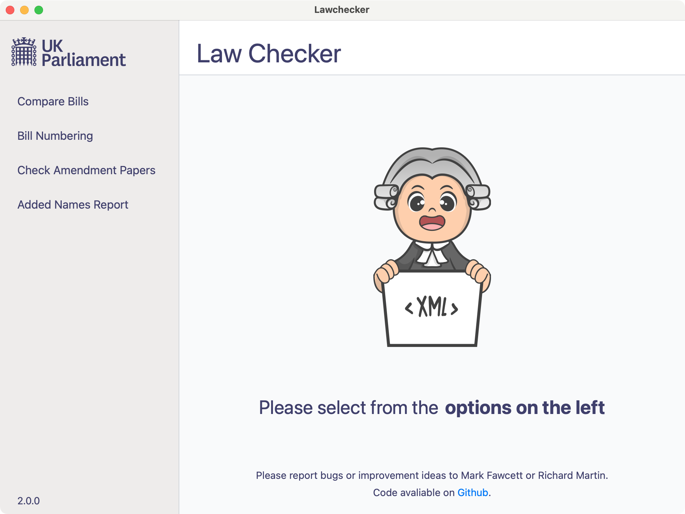

<p align="center">
  
</p>

# LawChecker

Automated checks/compares for UK Parliament legislative papers.

You can create:
- an HTML report which compares two Bill XML files
- CSV files showing changes to clause (a.k.a. section) and schedule paragraph numbers
- an HTML report which compares two Amendment paper XML files
- an HTML added names report
- an HTML report showing the differences between amendments in XML from LawMaker and from the Parliament website (via the bills API)

## Installation
Clone the repository if you have not already done so. [Here is a guide to cloning](https://www.youtube.com/watch?v=CKcqniGu3tA).
Install a recent version of [Python](https://www.python.org/downloads/) if you have not got one.

**If you wish to change the code** and/or create a distributable version (e.g. a .exe file on windows), you will need to have [Node](https://nodejs.org/en) installed too.

### Install via uv (recommended)

Install uv if you have not already done so, [see the installation guide](https://docs.astral.sh/uv/getting-started/installation/).

```bash
uv sync --extra gui && npm install
```
uv installs the development tools (the `dev` group) automatically. `uv sync` removes packages that are not listed in `pyproject.toml`, including pywebview if you leave out `--extra gui`.

#### If you only require the command line tools
You can install just the command line tools (without the GUI). Instead of the above command, run:

```bash
uv sync
```

### Or install with pip

#### Create and activate a python virtual environment (recommended).
To create a virtual environment run the following in PowerShell on Windows or in the terminal on Mac or Linux.

<details>
<summary>On Windows</summary>

Create:
```bash
python -m venv venv
```

To activate on Windows, run:
```powershell
venv\Scripts\Activate.ps1
```

If you run into permission trouble, [this article](https://dev.to/aka_anoop/enabling-virtualenv-in-windows-powershell-ka3) may help.
</details>

<details>
<summary>On Mac OS (or Linux)</summary>

Create:
```bash
python3 -m venv venv
```

To activate, run:
```bash
source venv/bin/activate
```
</details>

#### Install the package (Required)

To use LawChecker normally, with the GUI, install the python package with:
```bash
pip install ".[gui]"
```
(The quotes are needed on a Mac.)

If you only need the command line tools, you can leave out the GUI. This does not install pywebview:
```bash
pip install .
```

If you intend to change the code (or create a distributable version), install the package in editable mode with the GUI and the development tools, *and* install the node dependencies. This needs pip 25.1 or later. Check with `pip --version`, and if necessary update it with `python -m pip install --upgrade pip`.

<details>
<summary>On Windows</summary>

Run in PowerShell:
```powershell
pip install -e ".[gui]" --group dev; npm install
```
</details>

<details>
<summary>On Mac (or Linux)</summary>

```bash
pip install -e ".[gui]" --group dev && npm install
```
</details>


## Usage
Once installed there are several entry points. You can run these from the command line/terminal/powershell.
 - `gui` will start a graphical user interface (seen above) which lets you create all of the below reports.
 - `compare_bills` creates a report detailing the differences between two Bill files. Type `compare_bills --help`  for usage info.
 - `bill_numbering` creates a CSV file showing changes to clause (a.k.a. section) and schedule paragraphs numbers. Type `bill_numbering --help`  for usage info.
 - `compare_report` creates a report detailing the differences between two Amendment paper XML files. Type `compare_report --help` for usage info.
 - `an_report` creates an added names report. Type `an_report --help` in your terminal or command prompt for help on how to use this.
 - `web_amendments` creates a report detailing the differences an amendment paper of proceedings paper and Amendments on the parliament webste. Type `web_amendments --help` for usage info.

### Examples

If you did not install via `uv`, make sure you have your environment activated (see above) then remove `uv run ` from the beginning of each example below.

#### compare_report example
```bash
uv run compare_report example_files/amendments/energy_rm_rep_0904.xml example_files/amendments/energy_day_rep_0905.xml
```

#### compare_bills example
```bash
uv run compare_bills "example_files/bills/Data Protection and Digital Information Bill - commons introduced.xml" "example_files/bills/Data Protection and Digital Information Bill - commons committee.xml"
```

See [examples.md](example_files/examples.md) for more

## Tests
To run tests `uv run pytest tests/` (or if not using uv `pytest tests/` with your environment activated).

## Create Standalone .exe or .app file

You can create an executable file (.exe file) on windows and a .app on Mac as distributable versions. This will allow you to run the GUI version on a computer without python or other dependencies installed. Since the distributable is not signed users may get a warning about security or be prevented from running the program.

You will need to be using a Windows computer to create the .exe file. And you will need to be using a Mac computer to create the .app file. You will also need to have Node installed (see installation above). On either sort of computer run the following command in the terminal or powershell:
```bash
uv run npm run build
```

You should then see the resulting file in the `dist` folder.
